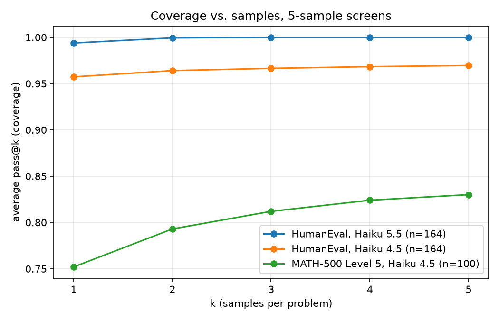

# predict-the-curve

Does repeated sampling with an automatic checker predictably raise how many problems a model solves? I tried to reproduce that idea at small scale, and found that the answer depends heavily on whether the benchmark is hard enough to have a tail of difficult problems.

This is a mini-project from Stanford CS329A (Self-Improving AI Agents), Lecture 2 on test-time compute scaling. The lecture builds on the "Large Language Monkeys" result: coverage (the fraction of problems solved by at least one of k samples) keeps growing as you sample more, in domains where answers can be verified automatically.

## What I found

I ran two benchmarks with 5 samples per problem and computed average pass@k for k = 1 to 5.

| Run | Problems | Mean pass@1 | Solved at least once in 5 | pass@5 |
|---|---|---|---|---|
| HumanEval, Haiku 5.5 | 164 | 0.994 | 164 | 1.000 |
| HumanEval, Haiku 4.5 | 164 | 0.957 | 159 | 0.970 |
| MATH-500 Level 5, Haiku 4.5 | 100 | 0.752 | 83 | 0.830 |



Average pass@k by k (computed with the unbiased estimator):

| k | HumanEval, Haiku 5.5 | HumanEval, Haiku 4.5 | MATH-500 L5, Haiku 4.5 |
|---|---|---|---|
| 1 | 0.994 | 0.957 | 0.752 |
| 2 | 0.999 | 0.964 | 0.793 |
| 3 | 1.000 | 0.966 | 0.812 |
| 4 | 1.000 | 0.968 | 0.824 |
| 5 | 1.000 | 0.970 | 0.830 |

Note that the y-axis in the figure starts at 0.74, not 0.

**Takeaways**

1. **HumanEval is nearly saturated for both models.** Haiku 5.5 solves 160 of 164 problems on all 5 samples, and Haiku 4.5 gains only about 1 point from 1 to 5 samples. Coverage can only grow by solving problems that currently fail, and almost none are failing.
2. **MATH-500 Level 5 has a real spread.** Of 100 problems, 66 were solved on all 5 samples, 17 on none, and 17 on some. Going from 1 to 5 samples raises coverage by about 8 points, with diminishing returns (+4.1, +1.9, +1.2, +0.6).
3. **The two HumanEval runs fail on different problems.** For example, HumanEval/93 went from 4/5 (Haiku 5.5) to 0/5 (Haiku 4.5), while HumanEval/92 and 99 went the other way. With 5 samples per problem, treat this as suggestive.
4. **The scaling-law experiment needs a long tail.** The lecture's power law comes from a tail of hard problems with low but nonzero pass rates. The HumanEval runs have almost none, which is why I moved to a harder benchmark.

## Hypothesis (not tested)

In a small pilot with token metadata, Haiku 5.5 returned thinking blocks on 9 of 10 samples across two HumanEval problems (all 5 on HumanEval/145, 4 of 5 on HumanEval/104). On the MATH run, all 500 Haiku 4.5 responses were plain text. Since thinking is sequential compute built into the model, repeated sampling may add less on top of it. I have not run a controlled comparison, so this is an idea worth testing, not a result.

## What's in the repo

```
predict-the-curve/
  src/
    config.py          # which model and which run folder the scripts use
    problems.py        # seeded HumanEval subset, prompt and test builders
    executor.py        # extract code, run it in a sandboxed subprocess
    sampler.py         # HumanEval sampling (threaded, cached, resumable)
    grade.py           # HumanEval grading, writes results.json
    math_problems.py   # MATH-500 Level 5 loader, \boxed{} extraction, answer check
    math_sampler.py    # MATH sampling
    math_grade.py      # MATH grading
    metrics.py         # unbiased pass@k estimator
    summary.py         # pass@1 buckets and list of failing problems
    audit_math.py      # reference answer next to the model's wrong answers
    inspect_samples.py # stop reasons, token usage
    plot_screen.py     # coverage plot
  data/
    haiku-5-5/         # HumanEval samples, grades, results
    haiku-4-5/         # HumanEval samples, grades, results
    math-haiku-4-5/    # MATH-500 Level 5 samples, grades, results
  plots/
    screen_coverage.png
```

## Design choices

- **Sampling and grading are separate.** Sampling costs money and grading is free, so a grader bug never forces a re-sample.
- **Everything is cached to disk** in append-only JSONL files, so a crashed run resumes where it stopped.
- **The HumanEval grader was validated before use.** A known-correct solution passes and a known-broken stub fails.
- **Generated code runs in a subprocess** with a timeout, a temp directory, and environment variables with "KEY" in the name stripped out.
- **Problem subsets are seeded** (seed 42), so anyone who clones the repo gets the same problems.
- **I screened before spending.** A 5-sample screen on all of HumanEval showed it was saturated before I committed to a larger run.

## Sampling settings

Settings used for sampling: temperature 1.0 (passed through `extra_body`, since the installed Anthropic Python SDK rejected it as a direct argument), `max_tokens` of 4000, 8 worker threads. Sample-to-sample variation was confirmed by running the same prompt twice and getting different outputs.

Models: `claude-haiku-5-5` and `claude-haiku-4-5-20251001`. Datasets: `openai/openai_humaneval` and `HuggingFaceH4/MATH-500`, filtered to Level 5, 100 problems drawn with a fixed seed from a pool of 134.

Token usage on the MATH run averaged about 167 input and 978 output tokens per call (500 calls), with no truncated answers (all stop reasons were `end_turn`).

## Reproducing the results

Install dependencies and set your API key (these are Windows PowerShell commands):

```powershell
py -m venv .venv
.venv\Scripts\Activate.ps1
pip install -r requirements.txt
$env:ANTHROPIC_API_KEY="your-key-here"
```

Edit `src/config.py` to choose the model and run folder, for example:

```python
MODEL = "claude-haiku-4-5-20251001"
RUN = "haiku-4-5"
```

HumanEval (164 problems, 5 samples each):

```powershell
python -m src.sampler 164 5
python -m src.grade 164
python -m src.summary
```

MATH-500 Level 5 (100 problems, 5 samples each), with `RUN = "math-haiku-4-5"`:

```powershell
python -m src.math_sampler 100 5
python -m src.math_grade 100
python -m src.summary
python -m src.audit_math
```

Plot:

```powershell
python -m src.plot_screen
```

All sampling scripts skip samples that are already cached, so rerunning after an interruption is safe.

## Limitations

- **Five samples per problem is coarse.** A problem at 0/5 could have a true pass rate of 0% or a few percent, and the scaling law depends on exactly that difference. That is why pass@5 is capped at 0.83 on MATH in this window.
- **No curve fit.** Five points from k = 1 to 5, with the last point fixed by the number of 0/5 problems, are too few to estimate a power-law exponent or forecast larger k. I describe the MATH curve as "diminishing returns", not as a power law.
- **MATH results are Level 5 only.** I chose the hardest problems on purpose, so 0.752 is not a model's overall MATH-500 score. Only Haiku 4.5 ran on MATH, so there is no model comparison there.
- **The MATH grader is string matching with light normalization** (spaces, `\dfrac`, units, degree markers, and a few similar cases). Spot checks with `audit_math.py` found real wrong answers, not formatting mismatches, but I have not reviewed every failure.
- **The five HumanEval problems at 0/5 for Haiku 4.5 have not been inspected.** Some could be flawed specs or tests instead of model failures.
- **Pass@k here is oracle coverage.** It assumes the correct answer can be identified among the samples, which in practice needs a verifier.

## Next steps

- Run 50 samples per problem on MATH-500 Level 5 and fit `c = exp(a * k^b)` on small k, then compare the forecast to the measured pass@k at larger k.
- Compare majority voting against oracle coverage to measure the verification gap.
- Test the adaptive-thinking hypothesis with a controlled comparison.

## Reference

Stanford CS329A, Lecture 2 (test-time compute scaling). The coverage-versus-samples idea comes from the "Large Language Monkeys" paper.
